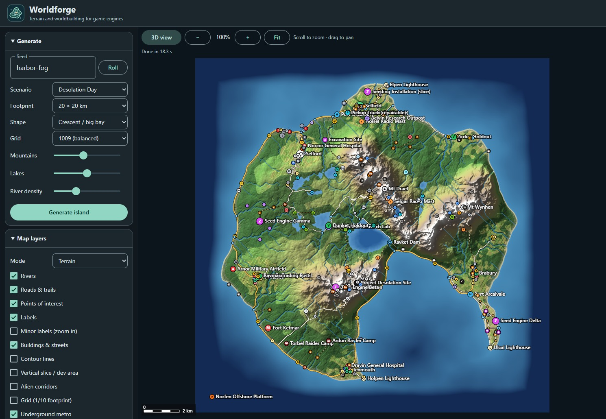
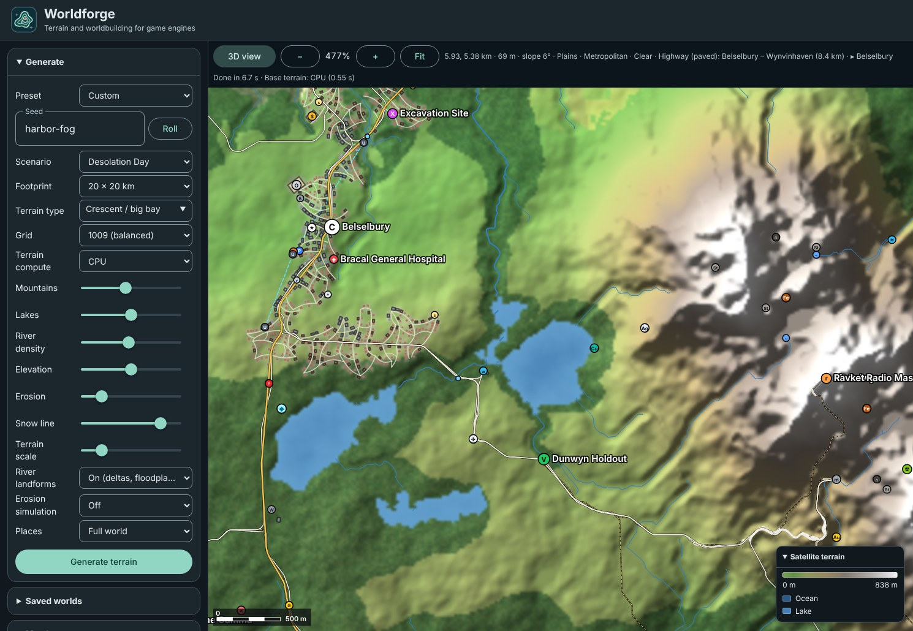
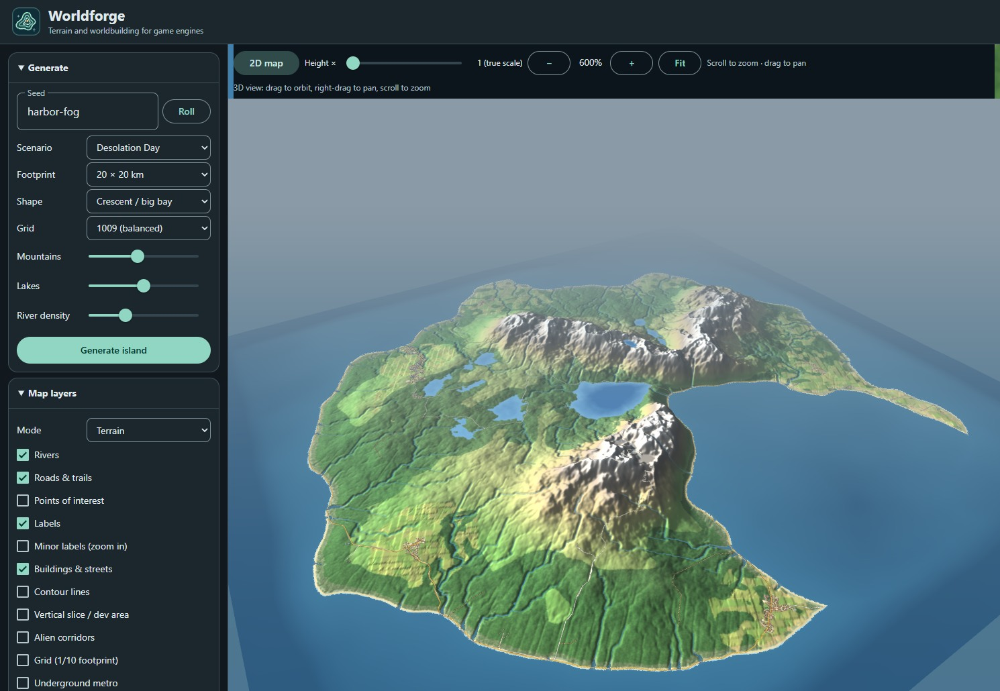
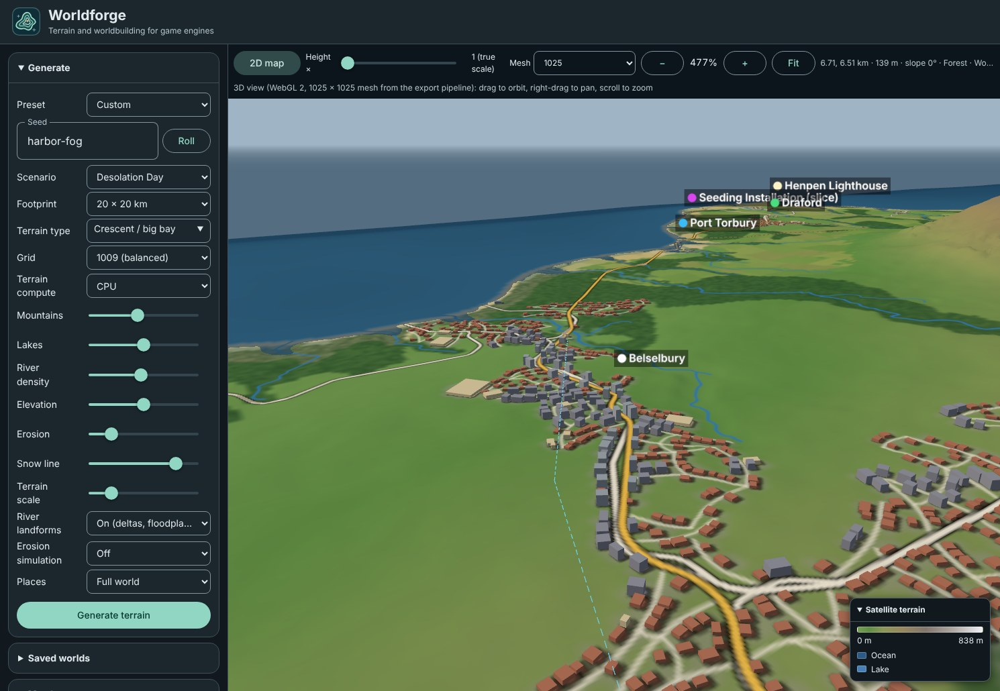

# Worldforge

[](https://www.buymeacoffee.com/armysarge)
[](https://developer.mozilla.org/en-US/docs/Web/JavaScript)
[](#terrain-compute)
[](https://github.com/material-components/material-web)
[](https://threejs.org/)

[](#unreal-engine)
[](#unity)
[](#godot)

Worldforge is a browser-based terrain and heightmap generator for game development. Generate islands or mainland regions with mountains, rivers, lakes, biomes, roads, settlements and resources. Inspect the world in 2D or 3D, then export terrain and map data for your engine.

I originally built Worldforge to help make the world for my game **Desolation Day**. I decided to share it so anyone building a game can use it for their own maps. The Desolation Day scenario is still included, alongside a general-purpose Sandbox.

## Map gallery

The four views show the same generated 20 km world from the **Desolation Day** scenario, using seed `harbor-fog`, the **Crescent / big bay** shape, a **1009** generation grid and **CPU** terrain compute.

| Island overview | City detail |
| --- | --- |
|  |  |
|  |  |

## Quick start

1. Open [index.html](index.html) in a modern desktop browser. The 2D generator runs locally with no build step. The 3D preview loads Three.js from a CDN.
2. Pick a scenario, seed, footprint, terrain type and generation grid. Use **505** for fast iteration, **1009** for a balanced grid, **2017** for finer generation, or **4033** for the most detailed simulation.
3. Click **Generate terrain**. The collapsible legend on the map follows the selected layer. Hover over controls for a description. When a metro network exists, **Underground metro** shows its cyan dashed alignments in 2D and 3D.
4. Pick an **Export size**, then use the export button for your engine. The generation grid drives the world simulation. A larger export adds terrain detail and resamples the existing world.

| Scenario | Generated world |
| --- | --- |
| **Sandbox** | The default. Terrain, settlements, infrastructure, resources, starting region and progression zones for a general game project. |
| **Desolation Day** | Adds seeding installations, infestation, story sites and survivor factions from the original project. |

Keep the seed, scenario and settings together when reproducing a map. Save the exported files for worlds you intend to keep across generator updates.

## Mainland terrain

Choose a preset under **Terrain type → Mainland**. The terrain extends to the map edge. Rivers that continue beyond the footprint are listed as `riverOutlets` in the world JSON.

| Terrain type | Landform |
| --- | --- |
| Rolling hills | Low ridges, broad valleys and gentle slopes. |
| Mountainous valleys | A winding lowland corridor between high ridges. |
| Stepped plateaus | Broad shelves above lower river valleys. |
| Coastal cliffs | A mainland coast with headlands, cliff sections and ocean along one side. |

**Elevation** scales vertical relief. **Erosion** controls how deeply catchment lines erode before river beds are carved. **Snow line** changes where snow appears in the biome and material layers. **Terrain scale** controls the size of terrain features. Higher values produce more closely spaced detail. The same seed and terrain controls work with **Satellite terrain**, **Topographic terrain**, and **Grayscale height** previews. Use the R16 or RAW export for full-precision engine height data. [Texturize Terrain Generator](https://texturize.app/generators/terrain)

## Terrain compute

**Auto** uses WebGPU for the base height field and small-scale terrain relief when the browser exposes a hardware adapter. The generator falls back to CPU when WebGPU is unavailable or the compute pass fails. The status line reports the backend and time spent on the base terrain pass. Drainage, rivers, roads, settlements and engine exports still run on the CPU.

**4033** generates roughly 16.3 million samples. On a 16 km footprint, samples are about 3.97 m apart. This grid needs substantially more system memory and time, even when WebGPU is active. **8129** is an export size.

Choose **CPU** to reproduce maps made before WebGPU support. The GPU shader uses 32-bit arithmetic, so small elevation differences can change a downstream river route or placement even with the same seed. World JSON and tile manifests record the backend used.

If Auto reports **CPU fallback**, check that browser graphics acceleration is enabled. If WebGPU is unavailable when opening the HTML directly, try serving the project folder on localhost. For example, run `python -m http.server 8000 --bind 127.0.0.1` and open `http://localhost:8000`. [Chrome WebGPU troubleshooting](https://developer.chrome.com/docs/web-platform/webgpu/troubleshooting-tips)

## Engine exports

| Engine | Export button | Output |
| --- | --- | --- |
| Unreal Engine | **Export Unreal package** | 16-bit R16, matching landscape layers and masks, JSON and CSV data, plus an optional editor Python script. |
| Unity | **Export Unity bundle** or **Unity heightmap** | The ZIP contains RAW height data, scale metadata, world JSON, eight matching weightmaps and an editor importer. The heightmap button exports only RAW and its settings. Both use the nearest supported resolution among 513, 1025, 2049 and 4097. |
| Godot | **Godot height data** | 16-bit little-endian RAW at the selected size and an import settings JSON. Import it with the Terrain3D add-on or read it in your own terrain system. |

The browser may ask to allow multiple downloads. Keep each RAW file beside its matching JSON. The 8-bit height PNG is for previewing elevations. Use RAW or R16 for engine terrain.

With a **4033** generation grid, select **Same as grid** to export native **4033 × 4033** height data for Unreal or the Terrain3D importer in Godot. The Unity exporter automatically resamples to **4097 × 4097**, a supported Unity Terrain resolution, while preserving the footprint. [Unreal Landscape sizes](https://dev.epicgames.com/documentation/unreal-engine/landscape-technical-guide-in-unreal-engine) · [Unity Terrain resolutions](https://docs.unity3d.com/6000.0/Documentation/ScriptReference/TerrainData-heightmapResolution.html) · [Terrain3D RAW import](https://terrain3d.readthedocs.io/en/stable/docs/import_export.html)

### Unreal Engine

1. Export the package and open its world JSON. Read the dimensions, scale and component settings under `unreal`.
2. In Landscape mode, import the R16 using those settings. Apply the exported location so sea level lands at Z = 0. For example, a 4033 landscape uses 63 quads per section, 2 × 2 sections per component, and 32 × 32 components.
3. Create matching Landscape material layers and Layer Info assets, then import the weightmaps at the same dimensions as the heightmap. Use the PCG masks separately for placement or exclusion.
4. To create markers and splines, enable the Python Editor Script Plugin and run the generated Python in your terrain level. Review the script header and set `SPLINE_BP` to your road Blueprint path. River setup uses the Water plugin when available. The script supplies layout data and markers for you to develop into game assets.

[Epic's Landscape Technical Guide](https://dev.epicgames.com/documentation/unreal-engine/landscape-technical-guide-in-unreal-engine) · [Custom heightmaps and layers](https://dev.epicgames.com/documentation/unreal-engine/creating-and-using-custom-heightmaps-and-layers-in-unreal-engine)

### Unity

For the ZIP workflow, extract the bundle into the Unity project root so the files land in `Assets/Worldforge`. Run **Tools → Worldforge → Create Terrain** to build a terrain asset and scene object at the exported scale and elevation. Assign your own Terrain Layers and use the PNGs in your material workflow. **Tools → Worldforge → Export Unity Package** lets Unity create a native `.unitypackage` from the imported assets.

For a manual heightmap import:

1. Export **Unity heightmap** and create a Terrain in Unity.
2. In Terrain Settings, under the heightmap resolution controls, choose **Import Raw**. Select the exported RAW, use **16 bit** depth and **little-endian** byte order (shown as **Windows** in some versions), and use the JSON's `width` and `height` for the resolution.
3. Set Terrain Width and Length to `footprintMeters`. Set Terrain Height to `verticalRangeMeters`, then set the Terrain object's Y position to `heightMinMeters` for sea level at world Y = 0.
4. Compare a distinctive coastline with the map preview before committing to the vertical flip setting. Keep the same row orientation when mapping textures, roads and POIs. Add Terrain Layers in Unity and use the separately exported masks as inputs to your texturing or placement pipeline.

[Unity heightmap import](https://docs.unity3d.com/6000.0/Documentation/Manual/terrain-Heightmaps.html) · [TerrainData resolutions](https://docs.unity3d.com/6000.0/Documentation/ScriptReference/TerrainData-heightmapResolution.html)

### Godot

1. Export **Godot height data**. Install a version of Terrain3D compatible with your Godot 4 project and open its `addons/terrain_3d/tools/importer.tscn` scene.
2. Choose the RAW as the height map. Enter `width` and `height` as the RAW dimensions and `heightMinMeters` and `heightMaxMeters` as the RAW elevation range. Start with import scale 1 and height offset 0, since the elevation range already restores the terrain's height and sea level.
3. Use `sampleSpacingMeters` for Terrain3D's vertex spacing. Check the region size against the add-on's limits for large files, then run the import and save the terrain data directory. Worldforge layer PNGs are separate density maps. Use Terrain3D's own control maps or materials to texture the imported terrain.

For a custom Godot terrain, decode the unsigned little-endian 16-bit samples with the formula below. Use the heights for a visible mesh and, if needed, a `HeightMapShape3D` collider. Its default horizontal spacing is 1 unit, so apply spacing and centering consistently to the mesh and collision.

[Terrain3D importer](https://terrain3d.readthedocs.io/en/stable/docs/import_export.html) · [Godot HeightMapShape3D](https://docs.godotengine.org/en/stable/classes/class_heightmapshape3d.html)

## Terrain tiles

Open **Terrain tiles**, choose Unreal or Unity, and pick a 2 × 2, 4 × 4, 8 × 8 or 16 × 16 grid. Turn on **Show tile grid and selection** and enter the column and row to locate a section. **Export selected tile** saves that section at the same resolution and position it would have in **Export all tiles**. Column 0 is west and row 0 is north.

Each Unreal tile is 1009 × 1009 and each Unity tile is 1025 × 1025. The neighbouring tiles share one row or column of vertices. An 8 × 8 Unreal grid on a 16 km world is equivalent to 8065 × 8065 samples, about 1.98 m apart. A 16 × 16 grid yields 16129 × 16129 samples at about 0.99 m apart. A 100 km world at the same grid size has about 6.20 m spacing.

1. **Unreal** — Extract the R16 files into one directory. In a World Partition level, select a tile in Landscape mode and accept the tiled import. Use the scale and section size in `tiles.json`. Align the northwest corner to the world origin, or use the tile's east and south offsets in metres for a single section. Compare a recognizable coast and river against the preview before applying the same orientation to other exports. For a very large grid, import and test subregions first to check landscape component counts and streaming performance. [Epic's tiled heightmap import guide](https://dev.epicgames.com/documentation/en-us/unreal-engine/importing-and-exporting-landscape-heightmaps-in-unreal-engine)
2. **Unity** — Extract the ZIP into the project root. Run **Tools → Worldforge → Create Terrain Tiles** and select the extracted `tiles.json`. The importer positions each tile at its world coordinates and connects neighbours listed in that manifest. Use **Export all tiles** when importing a complete set. [Unity's Terrain.SetNeighbors reference](https://docs.unity3d.com/6000.0/Documentation/ScriptReference/Terrain.SetNeighbors.html)

Export partial tiles from the same generated world, with the same edits, target engine and tile grid. Tiles add procedurally generated relief to the existing world and reapply river carving and grading at export resolution. The generation grid controls drainage, shorelines and settlement placement. Fine relief can leave small depressions between samples of that underlying simulation. Layer and PCG maps are separate exports. Tile generation works through one tile at a time on the CPU and shows progress as each tile finishes. The ZIP accumulates the finished tiles, so a full 16 × 16 export can still take roughly half a gigabyte before browser overhead.

## Data and scale

- Height data is row-major. The first sample is at the northwest corner, columns increase eastward and rows increase southward. The interval between adjacent vertices is the footprint width divided by `resolution - 1`.
- Decode a RAW sample as `heightMinMeters + (sample / 65535) * verticalRangeMeters`. Both the scale and the offset matter. Sea level is 0 m.
- **World data JSON** stores POIs, roads, lakes, streets, building footprints, resources and gameplay regions in metres from the northwest corner. The CSV button supplies tables with Unreal-style centimetre coordinates.
- **Layer weightmaps**, **Water mask** and **PCG masks** follow the selected export size. Unity's RAW uses the Unity-compatible dimensions from its own JSON. Use matching world bounds when resampling masks for a material or placement tool.
- Weightmaps blend biome coverage with slope, moisture, river and built-up ground. **Material weights** previews the combined surface. The Unity bundle resamples all eight weightmaps to the same size as its heightmap.
- Road structures in the world JSON include bridge deck points in metres. Local streets include elevation profiles, buildings have a foundation elevation, and metro links contain underground XYZ points. The Unreal script can import metro alignment splines using the road spline Blueprint. Use the structure data to build your bridge meshes and tunnel interiors.
- Exported heightmaps grade dry ground under building pads and roadbeds. Fine features depend on the export's vertex spacing, and grading preserves mapped river channels, water and lake rims.
- Exporting 8129 × 8129 can use significant browser memory. Iterate at a smaller size before exporting a large world.

## Editing and checking POIs

Use **Move POIs by dragging on the 2D map** and **Undo POI move** to adjust placements before exporting. Roadside facilities snap to a nearby surface street or road. Civic footprints follow their markers. City and town centers, deposits, and features tied to water or road geometry stay anchored to their generated positions. Generating another terrain clears your edits.

The **Surface access review** in World statistics lists road-oriented sites without a surface road within 100 m. The generator places civic facilities on street frontages and omits proposals it cannot place safely. Hospitals are limited to one per eligible settlement and spaced by the footprint with a 1.5 km minimum.

## Development

Open `index.html` directly from the project folder. Keep the stylesheet, `js/` and `assets/` beside it. The browser loads the local scripts in the order listed in the HTML.

| File | Responsibility |
| --- | --- |
| `index.html` | Page structure and controls |
| `styles.css` | Layout, theme and control styling |
| `js/terrain.js` | World generation, WebGPU terrain, height sampling and grading |
| `js/map.js` | 2D and 3D rendering, overlays, legends and map information |
| `js/exports.js` | Heightmaps, engine data, terrain tiles and import helpers |
| `js/app.js` | Startup, control events, navigation and POI editing |

Run these focused checks from the project directory with Node.js.

```sh
node test-island-shapes.cjs
node test-terrain.cjs
node test-engine-export.cjs
node test-settlements.cjs
```

